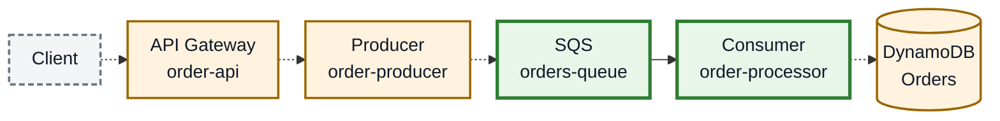
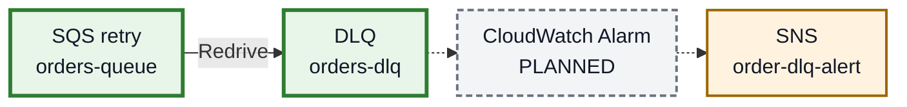

# Kiến trúc Tuần 1

Quan phụ trách sơ đồ tổng thể; Khôi xác nhận phần SV2. Sơ đồ thể hiện PoC và thiết kế đích, chưa chứng minh ứng dụng E2E chung đã hoạt động. Cấu hình, tên tài nguyên và nguồn minh chứng xem [danh mục AWS](../aws-inventory.md).

## 1. Sơ đồ chỉnh sửa được

Hai sơ đồ Mermaid dưới đây có thể sửa trực tiếp trong tài liệu.

### A. Kiến trúc xử lý đơn hàng

### B. Xử lý lỗi và cảnh báo

**Chú giải:** Xanh là PoC SV1 (Quan) đã kiểm thử; cam là thành phần SV2 (Khôi) triển khai riêng theo báo cáo; xám là thành phần dự kiến hoặc chưa xác nhận. Nét liền là luồng đã kiểm thử, nét đứt là đường chưa xác nhận hoặc cần tích hợp sau. Màu không thể hiện ranh giới tài khoản AWS.

SV1 dùng SQS Standard tại `us-east-1`, batch size **1**, maximum concurrency **2**. Khi xử lý thất bại, SQS cho nhận lại tin sau visibility timeout **60 giây**; Consumer không gửi tin lỗi trở lại queue. SQS chuyển tin sang DLQ theo `maxReceiveCount=3`.

Producer và Consumer là Lambda. Producer → SQS và Consumer → DynamoDB vẫn là đường tích hợp tương lai. Consumer PoC chỉ kiểm tra dữ liệu và ghi log, chưa ghi DynamoDB hoặc xử lý lặp an toàn cho nghiệp vụ; `ReportBatchItemFailures` đang tắt. Test dùng dữ liệu synthetic; log `/aws/lambda/order-processor` có `POC_VALIDATED` và `INVALID_SCHEMA` ([minh chứng](../evidence/week1/README.md#w1-q-e2e)).

Tên SV2 theo thông tin về ZIP Tuần 1 của Khôi, ghi tại [danh mục AWS](../aws-inventory.md); cấu hình chi tiết và các kết nối chưa được kiểm tra tại repo. CloudWatch Alarm và đường DLQ → Alarm → SNS còn **PLANNED**; SNS topic được báo cáo riêng, thông báo email còn chờ xác nhận subscription.

## 2. Quy tắc cho thiết kế tích hợp

- Producer kiểm tra body, chỉ trả `202 Accepted` khi gửi SQS thành công; input sai trả `400`, lỗi gửi trả `5xx` để client retry cùng `orderId`.
- Consumer đích ghi có điều kiện vào DynamoDB. Lỗi tạm thời/xung đột cần retry theo [hợp đồng tích hợp](../integration-contract.md); partial batch response chỉ dùng khi đã bật trên ESM. PoC Standard hiện tại không thực hiện các bước lưu trữ này.
- Nếu chuyển sang FIFO, queue nguồn/DLQ phải cùng loại và có hậu tố `.fifo`. Alarm dự kiến theo `ApproximateNumberOfMessagesVisible >= 1`, cần chốt kỳ đánh giá, quyền CloudWatch → SNS và xác nhận email trước khi nghiệm thu cảnh báo.

## 3. Checklist bàn giao

- [x] Có sơ đồ Mermaid chỉnh sửa được trong repo.
- [x] Có đủ API Gateway, Producer, SQS, Consumer, DynamoDB, DLQ, Alarm, SNS và email.
- [x] Phân biệt PoC SV1, phạm vi SV2 riêng và các đường tích hợp/lưu trữ tương lai.
- [x] Thể hiện luồng chính, retry/DLQ, thông báo và trách nhiệm; ghi rõ tài khoản tích hợp chưa xác nhận.
- [ ] Quan/Khôi rà soát nội dung, xác nhận cấu hình/kết nối SV2 và hoàn tất nộp theo yêu cầu giảng viên.

Đã tạo bản sơ đồ tài liệu; chưa coi đây là phê duyệt của sinh viên hoặc bằng chứng hoàn thành tích hợp.
