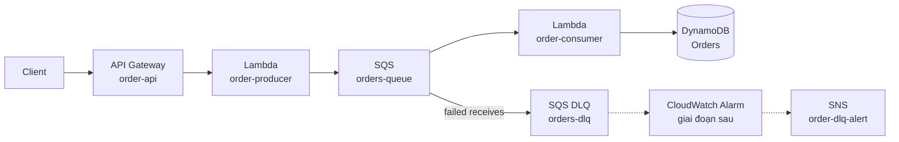
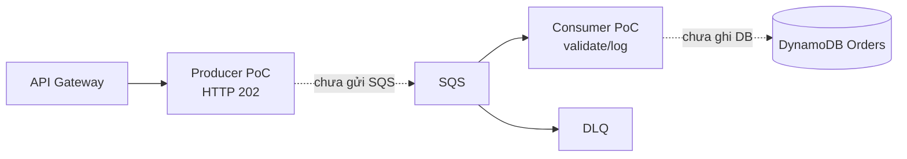
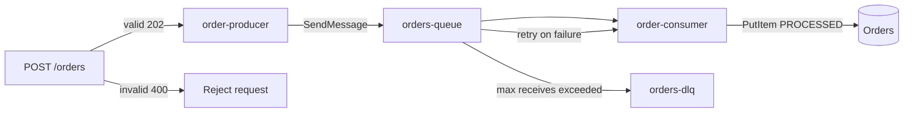
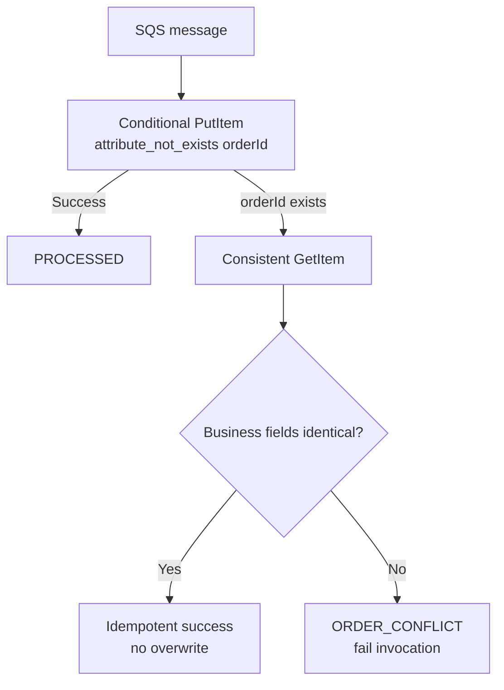

# Kiến trúc hệ thống — phân tách rõ Tuần 1 và Tuần 2

## 1. Kiến trúc đích

---

## 2. Tuần 1 — PoC độc lập

Đặc điểm:
- Khôi kiểm thử API/Producer riêng.
- Quân kiểm thử SQS/Consumer/DLQ riêng.
- Chưa dùng Full E2E làm kết luận Tuần 1.

---

## 3. Tuần 2 — luồng tích hợp

Đã kiểm thử trên Lab Quân:
- Full E2E.
- Idempotency.
- ORDER_CONFLICT.
- Invalid JSON → Retry → DLQ.
- Direct batch/replay.
- Small load test.

Đã kiểm thử trên Lab Khôi:
- Producer valid `202`.
- Producer invalid `400`.
- Invalid request không làm tăng queue.

---

## 4. Idempotency

---

## 5. Phạm vi chưa coi là hoàn tất trong Tuần 2

- CloudWatch Alarm → SNS alert hoàn chỉnh.
- Benchmark Standard vs FIFO chính thức.
- IaC production-like.
- Stress/load test lớn.

Các phần này thuộc các tuần sau theo kế hoạch dự án.
