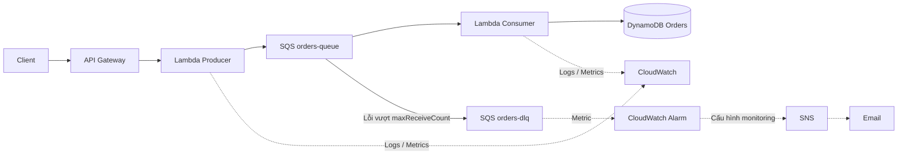
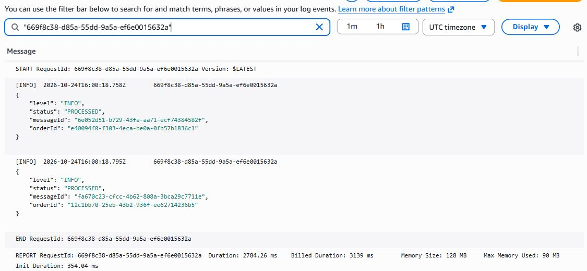

# BÁO CÁO CUỐI KỲ — XỬ LÝ ĐƠN HÀNG BẤT ĐỒNG BỘ TRÊN AWS

**Môn học:** CLC0332779_05UTExMC — Điện toán đám mây, HCMUTE

**GVHD:** TS. Huỳnh Xuân Phụng

**Nhóm:** Serverless

**Sinh viên:** Phạm Minh Quân — 24110311; Nguyễn Đoàn Minh Khôi — 24110259

**Môi trường:** AWS Academy Learner Lab, `us-east-1`, `LabRole`

**Ngày tổng hợp:** 29/10/2026

**Mã nguồn:** [pminhquan/cloud-async-orders](https://github.com/pminhquan/cloud-async-orders)

## 1. Bài toán và mục tiêu

Khi xử lý đơn hàng đồng bộ, phía gửi phải chờ toàn bộ công việc ghi dữ liệu và xử lý nghiệp vụ hoàn tất. Tải tăng hoặc dịch vụ hạ nguồn chậm có thể kéo dài thời gian phản hồi. Đề tài tách bước tiếp nhận đơn khỏi bước xử lý bằng hàng đợi, đồng thời xây dựng cơ chế kiểm tra dữ liệu, chống ghi đè khi phát lại và cách ly message không xử lý được.

Mục tiêu là triển khai một pipeline serverless có thể kiểm chứng từ API tới cơ sở dữ liệu; quan sát lỗi và retry; đo một số đặc tính của Standard/FIFO trong điều kiện thực hành; đánh giá chi phí và quản lý tài nguyên an toàn. Phạm vi nghiệp vụ là tiếp nhận và lưu đơn, chưa bao gồm thanh toán, tồn kho hoặc giao vận.

## 2. Yêu cầu và kiến trúc

Hệ thống tiếp nhận `POST /orders`, trả `202` khi đã gửi message thành công vào SQS và trả `400` khi dữ liệu không hợp lệ. Consumer phải lưu trạng thái `PROCESSED`, xử lý message phát lại mà không ghi đè dữ liệu, từ chối cùng mã đơn nhưng khác nội dung và giữ message lỗi trong cơ chế retry/DLQ. Kiểm thử cần đối soát cùng `orderId`, giới hạn tải và không làm mất dữ liệu lịch sử.



Sơ đồ mô tả kiến trúc logic của nhóm, không phải sơ đồ triển khai xuyên tài khoản. Pipeline E2E được kiểm chứng trong Lab Quân. Các cạnh nét đứt DLQ → Alarm → SNS → Email thể hiện thiết kế monitoring, chưa phải chuỗi metric-driven đã được xác minh trên Lab Quân. Bằng chứng manual của Lab Khôi là kịch bản lịch sử độc lập được trình bày ở phần giám sát. SQS đệm tải và tách vòng đời API khỏi Consumer. Lambda thực thi theo sự kiện; DynamoDB dùng khóa `orderId` và conditional write để bảo vệ dữ liệu. HTTP API Gateway phù hợp endpoint đơn giản. CloudWatch cung cấp log/metric, còn SNS phân phối thông báo. Không bổ sung máy chủ thường trực hoặc dịch vụ ngoài kiến trúc hiện có.

## 3. Hợp đồng dữ liệu và Producer

Request hợp lệ:

```json
{"customerId":"CUS001","productId":"P001","quantity":2}
```

`customerId` và `productId` phải là chuỗi không rỗng sau kiểm tra whitespace. `quantity` phải là số nguyên dương; bool, float và chuỗi số đều không hợp lệ. Producer kiểm tra body là chuỗi JSON chứa object, sau đó tạo UUID cho `orderId`, gán `PENDING`, thêm `createdAt` UTC và gửi message JSON phẳng tới SQS. Lỗi gửi SQS trả `500`, không trả `202` sai lệch.

Message có sáu trường chính: `orderId`, `customerId`, `productId`, `quantity`, `status`, `createdAt`. Consumer cho phép extra fields nhưng vẫn kiểm tra sáu trường bắt buộc. API response `202` chứng minh bước tiếp nhận đã hoàn tất, chưa chứng minh Consumer đã xử lý. [Hợp đồng đầy đủ](integration-contract.md), [Producer](../src/producer/lambda_function.py).

## 4. Consumer, DynamoDB và độ tin cậy

Consumer đọc từng phần tử `event.Records`, giải mã `body`, kiểm tra schema rồi thực hiện `PutItem` với điều kiện `attribute_not_exists(orderId)`. Item được lưu với `status=PROCESSED`. Khi điều kiện ghi thất bại vì mã đơn đã tồn tại, Consumer dùng `ConsistentRead=True` để đối chiếu `customerId`, `productId`, `quantity`, `createdAt`.

Payload giống nhau được coi là phát lại hợp lệ; item được giữ nguyên. Payload khác dẫn tới `ORDER_CONFLICT`. Không so sánh `status` để kết luận conflict vì message có thể còn `PENDING` trong khi item đã `PROCESSED`. Cơ chế này bảo vệ tác động ghi vào bảng; không có nghĩa API tự nhận biết hai request nghiệp vụ giống nhau, vì mỗi request hợp lệ vẫn sinh UUID mới.

Consumer hiện dùng full-batch failure: một record lỗi làm invocation thất bại và lô có thể được gửi lại. Vì vậy idempotency cần thiết ngay cả với record đã xử lý thành công trước record lỗi. Chưa bật `ReportBatchItemFailures`; đây là giới hạn có chủ đích của implementation hiện tại. SQS chính dùng redrive `maxReceiveCount=5`, visibility timeout 60 giây trên Lab Quân; DLQ giữ message để phân tích thay vì tự xóa. [Consumer](../src/consumer/lambda_function.py), [kiểm thử Consumer](../tests/test_consumer.py).

## 5. Giám sát và phạm vi hai Learner Lab

Log Consumer chứa mã lỗi cố định và định danh có giới hạn độ dài; không ghi toàn bộ payload nghiệp vụ. Producer ghi dấu hiệu gửi SQS và mã đơn. Metrics hỗ trợ quan sát invocation, errors, throttles, duration và độ đầy hàng đợi. Collector của repo giữ dữ liệu thiếu dưới dạng trạng thái thiếu dữ liệu, không tự diễn giải thành số 0.

Template monitoring khai báo alarm cho DLQ visible messages, Consumer errors và throttles, tham chiếu SNS topic hiện có. Kiểm tra template thành công là bằng chứng IaC hợp lệ, không tự chứng minh stack đã triển khai. [Template](../iac/week3-monitoring.yaml), [collector](../scripts/collect_cloudwatch_metrics.py).

Trên Lab Khôi, bộ minh chứng ngày 24/10/2026 ghi nhận subscription confirmed, SNS publish/email và Alarm State thủ công dẫn tới email. Phép thử đó kiểm tra đường phân phối cảnh báo; không phải bằng chứng DLQ metric tự kích hoạt alarm. Inventory ngày 29/10/2026 trên Lab Quân ghi nhận log groups hoạt động nhưng chưa có alarm/topic của dự án. Hai môi trường không được trình bày như có cấu hình giống nhau. [Phạm vi minh chứng Khôi](week3-khoi-evidence.md), [inventory và thử nghiệm Tuần 4](week4-report.md).

## 6. Tiến trình bốn tuần

| Tuần | Công việc và kết quả |
|---|---|
| 1 | Nghiên cứu dịch vụ; Quân triển khai PoC SQS/DLQ/Consumer, Khôi triển khai PoC API/Producer/DynamoDB/SNS. Hai phía thử riêng, chưa có Full E2E. |
| 2 | Chốt schema phẳng; Producer gửi SQS, Consumer ghi DynamoDB; bổ sung validation, idempotency, conflict; thử E2E, retry/DLQ, direct batch và tải nhỏ. |
| 3 | Bổ sung benchmark, load/reconciliation, collector, monitoring IaC và CI; chạy B1 Standard/FIFO, B2 10 đơn, B3 SQS batch thật; Khôi cung cấp minh chứng SNS/Alarm thủ công. |
| 4 | Đối chiếu lại deployment và tài nguyên; cập nhật Producer bị drift về đúng main, bật ESM đúng nguồn; nghiệm thu E2E, validation, replay/conflict và quan sát retry; hoàn thiện phân tích, báo cáo và kịch bản demo. |

Tài liệu theo giai đoạn: [Tuần 1](week1-report.md), [Tuần 2](week2-report.md), [Tuần 3](week3-report.md), [Tuần 4](week4-report.md).

## 7. Phương pháp kiểm thử và kết quả

Kiểm thử offline dùng mocks cho SQS/DynamoDB, kiểm tra contract và nhánh lỗi. Kiểm thử AWS dùng dữ liệu riêng, request tuần tự có giới hạn, đọc DynamoDB nhất quán mạnh theo `orderId`, lọc log theo messageId và không purge/delete dữ liệu. Với conflict, dùng direct invocation để kiểm tra lỗi mà không tạo message conflict lặp lại không cần thiết trong queue chính.

Kiểm thử hồi quy ngày 29/10 đạt **56 tests và 114 subtests**; unittest đạt **56 tests**. Compileall, cfn-lint và bảy kiểm tra CLI help/dry-run đều thành công. Bộ kiểm thử Producer trước nghiệm thu đạt **18 tests, 7 subtests**. Các kiểm thử offline dùng mô phỏng dịch vụ và được phân biệt với kết quả AWS bên dưới. CI của mã nguồn tham chiếu `8b14e02` thành công. [Phương pháp và kết quả kiểm thử](evidence/week4/offline-validation.md).

Trên Lab Quân, mã Producer triển khai thiếu `_validate` đã được xác định bằng đối chiếu source. Bản cập nhật dùng đúng source ở commit main, có ZIP rollback trước thay đổi và kiểm tra lại hash sau triển khai. Consumer có AST tương đương implementation repo sau khi bỏ docstring nên được giữ nguyên. ESM được xác minh đúng `orders-queue` → `order-consumer` và bật khi queue trống.

Run `W4-20261029T065500Z` thực hiện 13 request: một ca hợp lệ trả `202`; 12 ca invalid trả `400` gồm malformed JSON, root array, thiếu trường, chuỗi rỗng và năm loại quantity sai. Đơn `e941e651-2be5-4a1e-9575-9bc47657967d` được đọc lại với trạng thái `PROCESSED`. Phát lại cùng payload qua SQS có log xử lý và item không thay đổi; direct conflict `quantity=99` trả `ORDER_CONFLICT` và giữ nguyên item. [Ma trận nghiệm thu chi tiết](week4-report.md).

Một sentinel invalid JSON mới được nhận/xử lý lỗi năm lần theo đúng messageId, cách nhau khoảng 60 giây; sau đó main queue trống và DLQ tăng từ 2 lên 3. Đây là bằng chứng tương quan redrive theo maxReceiveCount=5; nhóm không đọc body DLQ hoặc can thiệp hai message cũ. Metrics của cửa sổ nghiệm thu ghi nhận Producer 13 invocation/0 lỗi, Consumer 8 invocation/6 lỗi dự kiến và không throttling. Không sử dụng sáu lỗi do phép thử tạo để kết luận hệ thống có sáu lỗi ngoài dự kiến.

## 8. Đánh giá hiệu năng từ số đo thật

Các số sau thuộc **ngày 24/10/2026**, tái sử dụng cho phân tích Tuần 4. B1 là benchmark SQS API riêng, client tuần tự, `batchSize=1`, 20 message mỗi kịch bản; không có Consumer tham gia.

| Kịch bản B1 | Gửi/nhận đủ | Send throughput (msg/s) | Median send (ms) | P95 send (ms) |
|---|---:|---:|---:|---:|
| Standard | 20/20 | 2,880 | 243,891 | 260,606 |
| FIFO, 1 group | 20/20 | 2,734 | 246,461 | 254,454 |
| FIFO, 5 groups | 20/20 | 2,007 | 298,031 | 957,534 |

Nguồn: [Standard](evidence/week3/quan/b1-2026-10-24/standard/benchmark-summary.json), [FIFO 1 group](evidence/week3/quan/b1-2026-10-24/fifo-single/benchmark-summary.json), [FIFO 5 groups](evidence/week3/quan/b1-2026-10-24/fifo-multi/benchmark-summary.json). Dấu phẩy trong bảng là dấu thập phân.

Ba kịch bản đều gửi/nhận đủ, không thấy duplicate trong tập mẫu. Standard ghi nhận sai thứ tự; FIFO giữ thứ tự trong từng group ở lần chạy này. Client tuần tự và độ trễ mạng chi phối throughput; không dùng số 2–3 msg/s làm giới hạn của SQS hoặc kết luận nhiều group luôn chậm hơn. Mẫu 20 message và một lần chạy không đủ để suy ra năng lực production hoặc xác suất mất/trùng message.

B2 gửi 10 request tuần tự: 10/10 HTTP `202`, mean API latency 931,091 ms, median 824,446 ms, P95 1.798,399 ms. Đợt đối soát sau gửi mất 3,5846 giây và xác nhận đủ 10 item `PROCESSED`; đây không phải latency E2E của từng đơn. [Dữ liệu B2](evidence/week3/quan/b2-2026-10-24/load/load-test-summary.json).

B3 chứng minh hai record SQS trong cùng invocation `669f8c38-d85a-55dd-9a5a-ef6e0015632a`: duration 2.784,26 ms, billed duration 3.139 ms, memory 128 MB. Đây là bằng chứng batch thật, khác direct Lambda test ở Tuần 2. [Batch proof](evidence/week3/quan/b3-2026-10-24/batch-proof.json).



Hướng tối ưu có căn cứ là cân nhắc batch để giảm invocation nhưng đo lại ảnh hưởng full-batch retry; chọn memory/timeout dựa trên billed duration và phân bố lỗi; giới hạn concurrency theo Lab. Không đổi cấu hình chỉ để tạo tuyên bố tối ưu. Standard phù hợp khi không cần thứ tự toàn cục và ứng dụng đã chống tác động duplicate; FIFO cần thiết khi nghiệp vụ yêu cầu thứ tự theo group.

## 9. Đánh giá chi phí

Chi phí phụ thuộc số API calls, số lần Lambda chạy và GB-seconds, thao tác/dung lượng message SQS, capacity và kích thước item DynamoDB, log/metric/alarm CloudWatch, publish và delivery SNS. Retry và duplicate làm tăng thao tác; validation sớm tránh công việc hạ nguồn không hợp lệ. Giảm memory không đương nhiên giảm tiền nếu duration tăng.

Đề tài áp dụng nguyên tắc tránh hoạt động thừa, tái dùng benchmark có provenance, giữ kiểm thử tải nhỏ và không bật dịch vụ bổ sung. Không dùng widget ngân sách Lab làm hóa đơn từng dịch vụ, không mặc định Free Tier của tài khoản cá nhân áp dụng cho Learner Lab. Mô hình, giả định và nguồn giá chính thức được trình bày trong [đánh giá chi phí](week4-cost-analysis.md); không công bố số tiền thanh toán chưa được đối soát.

## 10. Bảo mật và quản lý dữ liệu

Execution role là `LabRole`; không tạo IAM user/role mới, không ghi access key/token vào source hoặc minh chứng. Producer/Consumer lấy target qua environment variables. Consumer dùng mã lỗi cố định, ràng buộc độ dài định danh log và kiểm tra dữ liệu từ queue. Conditional write bảo vệ dữ liệu trước ghi đè do xử lý lặp.

Inventory hiện tại ghi nhận API route có `AuthorizationType=NONE`. Đây là endpoint thực hành, chưa đáp ứng nhu cầu xác thực và kiểm soát truy cập của dịch vụ sản xuất. Khi phát triển ngoài Lab cần thiết kế authorization, giới hạn request, ràng buộc payload và IAM theo quyền tối thiểu. Không mở rộng public access hoặc đổi chính sách IAM trong đợt nghiệm thu này.

## 11. Quản lý tài nguyên và tổ chức demo

Giữ queue chính, DLQ, bảng Orders, Lambda, API, ESM và log phục vụ demo. Queue benchmark rỗng được phân loại REVIEW để chủ Lab xem xét sau nghiệm thu; không xóa chỉ để đánh dấu hoàn thành checklist. Không nhận hoặc xóa hai message DLQ lịch sử. Retention log hiện chưa được đặt; trước khi rút ngắn cần lưu bằng chứng và xét nguy cơ mất log cũ.

[Kịch bản demo](demo-script.md) chia vai Quân/Khôi, thời lượng mục tiêu 9 phút 20 giây, trình bày luồng xử lý, nghiệm thu và đánh giá kỹ thuật. Minh chứng lịch sử được giới thiệu theo đúng ngày và môi trường thực hiện.

## 12. Giới hạn và kết luận

Kết quả chứng minh pipeline bất đồng bộ, validation, bảo vệ item khi phát lại và phân biệt conflict trong phạm vi thực hành. Việc đối chiếu source triển khai phát hiện lỗi mà kiểm thử source đơn thuần không thấy; do đó nghiệm thu phải kiểm tra cả deployment và dữ liệu cuối.

Mẫu hiệu năng còn nhỏ; batch failure chưa tách record; API chưa có authorization; monitoring giữa hai Lab khác nhau. Các giới hạn này là cơ sở cho hướng phát triển tiếp theo, gồm xác thực API, partial batch failure và kiểm thử tải có phương pháp rộng hơn. [Ma trận nghiệm thu Tuần 4](week4-execution.md) tổng hợp phạm vi và dẫn chiếu kết quả.

## 13. Tài liệu tham khảo và phụ lục

- [Hợp đồng tích hợp](integration-contract.md), [traceability bốn tuần](TRACEABILITY-W1-W2.md), [phân công](task-assignment.md), [khai báo AI](ai-declaration.md).
- [Chỉ mục minh chứng Tuần 1](evidence/week1/README.md), [Tuần 2](evidence/week2/README.md), [Tuần 3](evidence/week3/README.md), [Tuần 4](evidence/week4/README.md).
- AWS: [Lambda với SQS](https://docs.aws.amazon.com/lambda/latest/dg/with-sqs.html), [SQS DLQ](https://docs.aws.amazon.com/AWSSimpleQueueService/latest/SQSDeveloperGuide/sqs-dead-letter-queues.html), [DynamoDB conditional writes](https://docs.aws.amazon.com/amazondynamodb/latest/developerguide/Expressions.ConditionExpressions.html).
- Nguồn giá từng dịch vụ và ngày truy cập nằm trong [phân tích chi phí](week4-cost-analysis.md).
